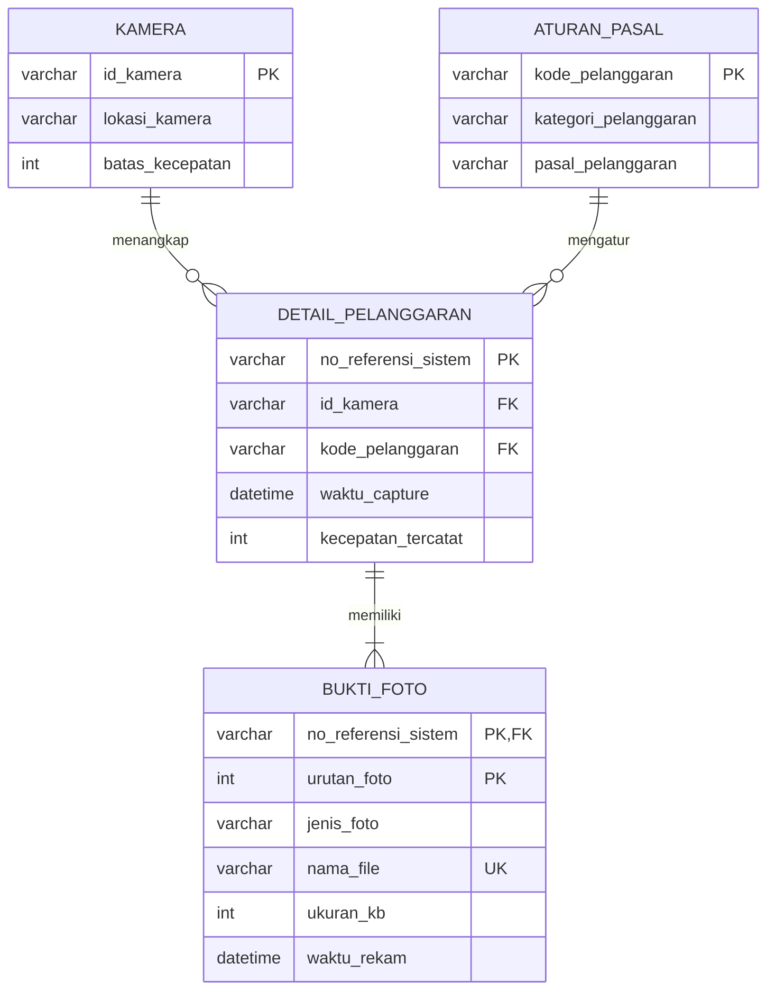

# UTS: Fitur Bukti Foto Pelanggaran

## 1. Pemodelan Konseptual: ERD Fitur Bukti Foto Pelanggaran

**Nama:** Bilqis Audynova Prasanty | **NIM:** 264311063 | **Kelas:** 1C | **Prodi:** TRPL

**Penambahan proses bisnis:** setiap pelanggaran ETLE wajib disertai satu atau lebih foto bukti (foto kendaraan, foto plat nomor, foto situasi).

## Keterangan

| Relasi | Kardinalitas | Keterangan |
|---|---|---|
| KAMERA - DETAIL_PELANGGARAN | 1 : N | Satu kamera menangkap banyak pelanggaran |
| ATURAN_PASAL - DETAIL_PELANGGARAN | 1 : N | Satu pasal mengatur banyak pelanggaran |
| DETAIL_PELANGGARAN - BUKTI_FOTO | 1 : N | Satu pelanggaran memiliki 1..N foto bukti |

`BUKTI_FOTO` adalah **entitas lemah**: tidak dapat berdiri sendiri tanpa `DETAIL_PELANGGARAN`, sehingga primary key-nya gabungan (`no_referensi_sistem` + `urutan_foto`).

Script SQL: [uts_remedi_bilqis.sql](uts_remedi_bilqis.sql)
