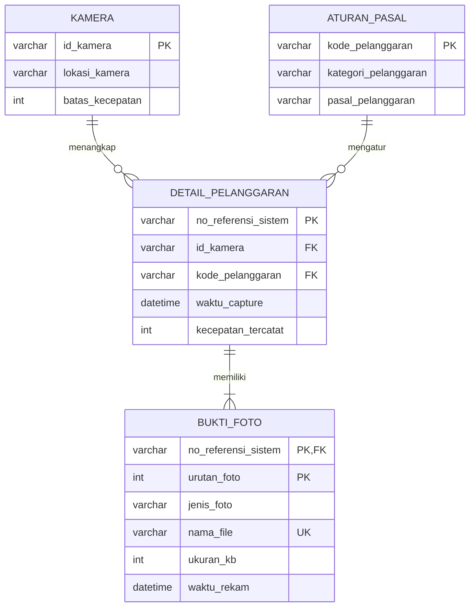
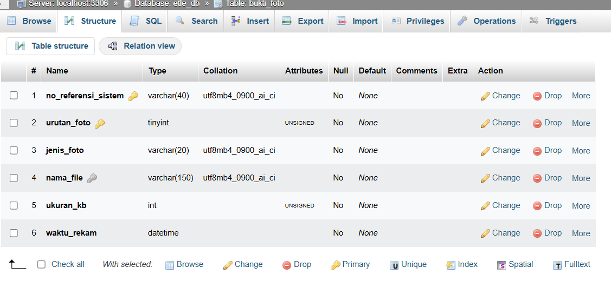
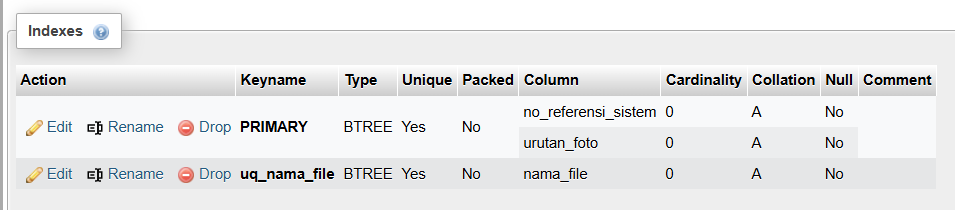
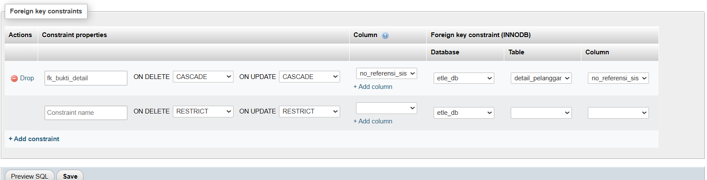

# UTS: Fitur Bukti Foto Pelanggaran

## 1. Pemodelan Konseptual: ERD Fitur Bukti Foto Pelanggaran

**Nama:** Bilqis Audynova Prasanty | **NIM:** 264311063 | **Kelas:** 1C | **Prodi:** TRPL

**Penambahan proses bisnis:** setiap pelanggaran ETLE wajib disertai satu atau lebih foto bukti (foto kendaraan, foto plat nomor, foto situasi).



## Keterangan

| Relasi | Kardinalitas | Keterangan |
|---|---|---|
| KAMERA - DETAIL_PELANGGARAN | 1 : N | Satu kamera menangkap banyak pelanggaran |
| ATURAN_PASAL - DETAIL_PELANGGARAN | 1 : N | Satu pasal mengatur banyak pelanggaran |
| DETAIL_PELANGGARAN - BUKTI_FOTO | 1 : N | Satu pelanggaran memiliki 1..N foto bukti |

`BUKTI_FOTO` adalah **entitas lemah**: tidak dapat berdiri sendiri tanpa `DETAIL_PELANGGARAN`, sehingga primary key-nya gabungan (`no_referensi_sistem` + `urutan_foto`).

## 2. Pemodelan Logis

### a. Skema Relasional

```
KAMERA             (id_kamera PK, lokasi_kamera, batas_kecepatan)
ATURAN_PASAL       (kode_pelanggaran PK, kategori_pelanggaran, pasal_pelanggaran)
DETAIL_PELANGGARAN (no_referensi_sistem PK, id_kamera FK, kode_pelanggaran FK,
                    waktu_capture, kecepatan_tercatat)
BUKTI_FOTO         (no_referensi_sistem PK/FK, urutan_foto PK, jenis_foto,
                    nama_file, ukuran_kb, waktu_rekam)          <- tabel baru
```

### b. Normalisasi (UNF sampai 3NF)

Contoh data: satu pelanggaran dengan 3 foto bukti.

#### UNF
Satu baris pelanggaran berisi banyak foto sekaligus (kelompok berulang).

| no_referensi_sistem | id_kamera | lokasi_kamera | waktu_capture | kecepatan | foto |
|---|---|---|---|---|---|
| 910-50639-AE1270CR | CAM-TOL-548 | SPEEDCAM TOL KM 548+450 A JSN | 2026-03-04 09:42:11 | 144 | (1 Kendaraan: ae1270cr_depan.jpg), (2 Plat Nomor: ae1270cr_plat.jpg), (3 Situasi: ae1270cr_situasi.jpg) |

#### 1NF
Satu baris = satu foto di satu pelanggaran. Kunci gabungan: (no_referensi_sistem, urutan_foto).

| no_referensi_sistem | urutan_foto | id_kamera | lokasi_kamera | waktu_capture | kecepatan | jenis_foto | nama_file |
|---|---|---|---|---|---|---|---|
| 910-50639-AE1270CR | 1 | CAM-TOL-548 | SPEEDCAM TOL KM 548+450 A JSN | 2026-03-04 09:42:11 | 144 | Kendaraan | ae1270cr_depan.jpg |
| 910-50639-AE1270CR | 2 | CAM-TOL-548 | SPEEDCAM TOL KM 548+450 A JSN | 2026-03-04 09:42:11 | 144 | Plat Nomor | ae1270cr_plat.jpg |
| 910-50639-AE1270CR | 3 | CAM-TOL-548 | SPEEDCAM TOL KM 548+450 A JSN | 2026-03-04 09:42:11 | 144 | Situasi | ae1270cr_situasi.jpg |

Masalah: data kamera dan waktu capture terulang di setiap foto (redundansi).

#### 2NF
`id_kamera`, `lokasi_kamera`, `waktu_capture`, dan `kecepatan` hanya bergantung pada `no_referensi_sistem` (sebagian kunci), sehingga dipindah ke tabel DETAIL_PELANGGARAN.

**DETAIL_PELANGGARAN**

| no_referensi_sistem (PK) | id_kamera | lokasi_kamera | waktu_capture | kecepatan |
|---|---|---|---|---|
| 910-50639-AE1270CR | CAM-TOL-548 | SPEEDCAM TOL KM 548+450 A JSN | 2026-03-04 09:42:11 | 144 |

**BUKTI_FOTO**

| no_referensi_sistem (PK, FK) | urutan_foto (PK) | jenis_foto | nama_file |
|---|---|---|---|
| 910-50639-AE1270CR | 1 | Kendaraan | ae1270cr_depan.jpg |
| 910-50639-AE1270CR | 2 | Plat Nomor | ae1270cr_plat.jpg |
| 910-50639-AE1270CR | 3 | Situasi | ae1270cr_situasi.jpg |

#### 3NF
`lokasi_kamera` bergantung pada `id_kamera`, bukan langsung pada `no_referensi_sistem` (ketergantungan transitif), sehingga dipisah ke tabel KAMERA.

**KAMERA**

| id_kamera (PK) | lokasi_kamera | batas_kecepatan |
|---|---|---|
| CAM-TOL-548 | SPEEDCAM TOL KM 548+450 A JSN | 120 |

**DETAIL_PELANGGARAN**

| no_referensi_sistem (PK) | id_kamera (FK) | waktu_capture | kecepatan_tercatat |
|---|---|---|---|
| 910-50639-AE1270CR | CAM-TOL-548 | 2026-03-04 09:42:11 | 144 |

**BUKTI_FOTO** (tidak berubah)

| no_referensi_sistem (PK, FK) | urutan_foto (PK) | jenis_foto | nama_file |
|---|---|---|---|
| 910-50639-AE1270CR | 1 | Kendaraan | ae1270cr_depan.jpg |
| 910-50639-AE1270CR | 2 | Plat Nomor | ae1270cr_plat.jpg |
| 910-50639-AE1270CR | 3 | Situasi | ae1270cr_situasi.jpg |

**Hasil akhir 3NF:** KAMERA, ATURAN_PASAL, DETAIL_PELANGGARAN, dan BUKTI_FOTO. Tidak ada lagi pengulangan data kamera di setiap foto, dan semua atribut non-kunci bergantung penuh pada kunci.

## 3. Pemodelan Fisik

Pemodelan fisik diterjemahkan menjadi script SQL DDL pada file [Remedial_UTS_ddl.sql](Remedial_UTS_ddl.sql). Tabel tambahan pada remedi ini adalah `bukti_foto`, yang menyimpan foto bukti dari setiap pelanggaran ETLE.

### Penjelasan tabel `bukti_foto`

| Elemen | Penjelasan |
|---|---|
| Primary Key | Gabungan `no_referensi_sistem` + `urutan_foto`, karena `bukti_foto` adalah entitas lemah dan setiap foto diidentifikasi lewat pelanggaran induknya beserta nomor urutnya |
| Foreign Key | `no_referensi_sistem` merujuk ke `detail_pelanggaran(no_referensi_sistem)` dengan `ON DELETE CASCADE` dan `ON UPDATE CASCADE`, sehingga foto ikut terhapus bila pelanggarannya dihapus |
| UNIQUE | `nama_file`, agar tidak ada dua foto dengan nama file yang sama |
| CHECK | `urutan_foto` antara 1 sampai 10, `jenis_foto` hanya `Kendaraan`, `Plat Nomor`, atau `Situasi`, dan `ukuran_kb` lebih dari 0 |
| NOT NULL | Semua kolom wajib diisi agar data bukti lengkap |
| Index | `idx_bukti_waktu` pada `waktu_rekam` untuk mempercepat pencarian foto berdasarkan waktu |

### Bukti pengujian di phpMyAdmin

**Struktur tabel `bukti_foto`** (ikon kunci menunjukkan primary key gabungan)



**Index tabel `bukti_foto`** (PRIMARY dan UNIQUE pada nama_file)



**Foreign key `fk_bukti_detail`** (relasi ke `detail_pelanggaran` dengan CASCADE)



---

Script SQL: [Remedial_UTS_ddl.sql](Remedial_UTS_ddl.sql)
